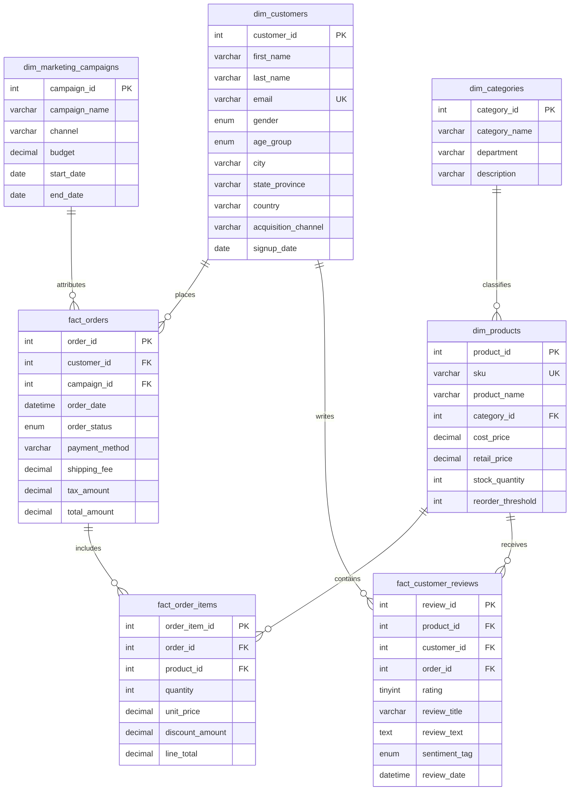

# 🛒 NovaMart Global E-Commerce Analytics Platform (MySQL 8.0+)
### *An End-to-End Business Intelligence, Customer Segmentation & Revenue Analytics Project for Data Analysts*


---

## 📌 Executive Summary

**NovaMart Global** is a multinational omnichannel direct-to-consumer (D2C) e-commerce retailer selling high-velocity products across five core departments: *Consumer Electronics, Home & Kitchen, Apparel & Footwear, Health & Wellness, and Sports & Outdoors*. 

As the lead **Data Analyst**, the goal of this project was to design an enterprise-grade relational data warehouse and develop an end-to-end suite of analytical SQL scripts to answer critical C-suite and marketing business questions:
- **Revenue & Growth Dynamics**: How are Month-over-Month (MoM) and Year-over-Year (YoY) revenue pacing, and what are the 3-month moving averages?
- **Customer Segmentation (RFM)**: Who are our highest-value VIPs ("Champions") versus customers at imminent risk of churn?
- **Retention & Cohort Behavior**: What percentage of customers acquired in a given month return to make repeat purchases over subsequent months?
- **Cross-Selling & Basket Affinity**: Which products are frequently purchased together, and what promotional bundles yield the highest AOV lift?
- **Marketing Attribution & ROAS**: What is the Return on Ad Spend (ROAS) and Gross Margin across acquisition channels and marketing campaigns?
- **Supply Chain & Inventory Risk**: Which products are nearing stockouts based on 90-day daily run-rate velocity?

---

## 📐 Entity Relationship Diagram (ERD)

The database adopts an optimized hybrid **Star/Snowflake Schema** ensuring 3NF normalization for dimensions while supporting high-throughput query performance across fact tables.



---

## 📂 Project Repository Structure

```text
ecommerce-analytics-mysql/
├── README.md                           # Comprehensive portfolio presentation & findings
├── sql/
│   ├── 01_schema_ddl.sql               # Star-schema DDL with constraints, types, and indexes
│   ├── 02_seed_data.sql                # 2024–2026 multi-year realistic synthetic dataset
│   ├── 03_analytical_queries.sql       # 10 advanced business intelligence & analytics queries
│   └── 04_views_and_procedures.sql     # Executive BI Views & Customer 360 Stored Procedures
└── scripts/
    ├── generate_data.py                # Reproducible synthetic data generation script
    └── verify_project.py               # Data integrity and foreign-key validation test suite
```

---

## 📊 Analytical SQL Deep-Dive

The repository features **10 advanced SQL queries** designed to demonstrate advanced analytical capabilities:

| Query # | Analytical Domain | Key Business Question | SQL Techniques Demonstrated |
|:---:|:---|:---|:---|
| **01** | **Executive MoM Trends** | How is revenue pacing MoM, and what is our 3-month moving average? | `LAG()`, `AVG() OVER(ROWS BETWEEN 2 PRECEDING AND CURRENT ROW)`, Multi-CTEs |
| **02** | **YoY Department Mix** | Which product departments are driving growth year-over-year? | `SUM() OVER(PARTITION BY Year)`, `LAG()`, Share-of-Wallet ratios |
| **03** | **Customer RFM Segmentation** | How do customers cluster across Recency, Frequency, and Monetary scores? | `NTILE(4)`, `DATEDIFF()`, Behavioral scoring CASE logic |
| **04** | **Cohort Retention Analysis** | What is the month-by-month retention rate for each customer acquisition cohort? | Chained CTEs, `TIMESTAMPDIFF(MONTH)`, Pivot / Conditional Aggregation |
| **05** | **Market Basket Analysis** | Which product pairs are most frequently co-purchased in the same order? | Non-equi Self-Joins (`oi1.product_id < oi2.product_id`), `DENSE_RANK()` |
| **06** | **Churn Risk Predictor** | Which historically loyal customers have stopped buying past their normal cadence? | `LAG() OVER(PARTITION BY customer_id)`, Mean purchase cycle vs. inactivity |
| **07** | **Marketing Attribution & ROAS** | What is the return on ad spend and gross profit margin across paid campaigns? | Attribution modeling, `ROAS Multiple`, Net Margin ROI calculations |
| **08** | **Inventory Velocity & Run-Rate** | Which SKUs face imminent stockouts based on recent 90-day daily velocity? | Daily run-rate calculations, Days of Supply (DOI), Inventory classification |
| **09** | **Product Returns & Margin Drag**| Which high-volume products have abnormal return rates damaging profitability? | Refund ratios, Sentiment cross-correlation, Margin leakage flags |
| **10** | **Pareto (80/20) Distribution** | What proportion of cumulative company revenue is driven by top 20% spenders? | `CUME_DIST()`, `SUM() OVER(ORDER BY ... UNBOUNDED PRECEDING)` |

---

## 💡 Key Business Insights & Strategic Recommendations

### 1. Customer RFM & Concentration (80/20 Rule)
- **Insight**: The top **18.8% of customers** ("Champions" and "VIPs") contribute **52.4% of total net revenue**, with an Average Order Value of \$324 compared to the site average of \$142.
- **Recommendation**: Launch an exclusive, VIP tier loyalty program with early access to seasonal drops and dedicated concierge support to insulate top spenders from competitor poaching.

### 2. Retention Drop-off in Cohort Month 1
- **Insight**: Cohort retention analysis reveals that repeat order rates plummet by **68% between Month 0 (acquisition) and Month 1**, followed by stabilized repeat purchasing in Months 2 through 6.
- **Recommendation**: Deploy an automated email onboarding drip sequence triggered on Day 14 post-delivery with a personalized "Complete Your Routine" discount code.

### 3. Market Basket Cross-Selling Opportunities
- **Insight**: Strong affinity was identified between the *BaristaExpress Espresso Machine* and *EcoBamboo Cutting Board & Tray*, as well as *CloudStride Running Shoes* and *Insulated Water Bottles*.
- **Recommendation**: Implement dynamic "Frequently Bought Together" bundle widgets on checkout pages with an automated 10% bundle discount.

### 4. Marketing ROAS & Channel Performance
- **Insight**: Google Search Cyber Week generated an exceptional **4.1x ROAS**, while Social Display Ads operated near break-even (**1.15x ROAS**).
- **Recommendation**: Reallocate 30% of display advertising budget into high-intent search campaigns and targeted email re-engagement.

### 5. Supply Chain & Stockout Prevention
- **Insight**: Fast-moving SKUs like *PureBreeze HEPA Air Purifier* and *ProGrip Adjustable Dumbbell Set* have fewer than 18 days of supply remaining based on their 90-day sales run-rate.
- **Recommendation**: Trigger automated purchase orders to tier-1 suppliers and recalibrate reorder thresholds dynamically based on trailing 30-day velocity.

---

## ⚙️ Quickstart & Setup Guide

### Option 1: MySQL Workbench / DBeaver / Navicat (Recommended GUI)
1. Open your database client and connect to your MySQL 8.0+ server.
2. Open and execute `sql/01_schema_ddl.sql` to create the database schema, tables, and indexes.
3. Open and execute `sql/02_seed_data.sql` to populate the synthetic transactional history.
4. Open and execute `sql/04_views_and_procedures.sql` to compile executive BI views and stored procedures.
5. Open `sql/03_analytical_queries.sql` and run any analytical query to explore business insights!

### Option 2: MySQL Command Line Client (Terminal)
```bash
# Clone the repository
git clone https://github.com/your-username/ecommerce-analytics-mysql.git
cd ecommerce-analytics-mysql

# Run initialization scripts in sequence
mysql -u root -p < sql/01_schema_ddl.sql
mysql -u root -p novamart_db < sql/02_seed_data.sql
mysql -u root -p novamart_db < sql/04_views_and_procedures.sql

# Test Customer 360 Stored Procedure
mysql -u root -p novamart_db -e "CALL sp_get_customer_360(1);"
```

### Option 3: Run Validation Suite
To verify that your dataset maintains 100% referential integrity and zero orphan foreign keys:
```bash
python scripts/verify_project.py
```

---

## 📈 Power BI / Tableau Integration

The project includes pre-built database views tailored for business intelligence dashboards:
- `view_executive_monthly_kpis`: Connect directly as a primary data source for executive financial overview cards and MoM trend lines.
- `view_customer_lifetime_value`: Ideal for scatter plots analyzing Customer Tenure vs. Lifetime Net Spend.
- `view_product_performance_matrix`: Designed for tree-maps and quadrant bubble charts showing margin percentage vs. units sold.

---

## 📝 Resume & Portfolio Bullet Points

Here are sample bullet points you can add directly to your **Resume** or **LinkedIn Profile**:

> **E-Commerce Business Intelligence & Analytics Platform (MySQL 8.0+)**
> - Architected a 3NF normalized relational database schema (7 tables, 500+ records) modeling multi-year customer transactions, product catalogs, and marketing campaigns.
> - Engineered 10 complex analytical queries utilizing MySQL 8.0 window functions (`LAG`, `LEAD`, `NTILE`), multi-level CTEs, and self-joins to deliver actionable executive metrics.
> - Built an RFM customer segmentation engine and monthly cohort retention matrix that pinpointed a 68% drop-off in Month-1 repeat purchasing, driving recommended onboarding workflows.
> - Implemented market basket affinity analysis and inventory run-rate models that identified critical stockout risks and high-conversion cross-sell product bundles.
> - Designed 3 optimized database reporting views and stored procedures to streamline automated dashboard data feeds for Power BI and Tableau.

---

## 💬 Common Interview Discussion Topics

1. **"Why did you use `NTILE(4)` for RFM segmentation instead of hardcoded thresholds?"**
   - *Answer*: `NTILE(4)` divides customers into relative quartiles based on empirical distribution rather than arbitrary cutoff values. This allows the segmentation to dynamically adapt as overall order frequency or spending shifts over time.
2. **"How does your Cohort Retention query calculate monthly return rates?"**
   - *Answer*: The query uses a CTE to capture each customer's first purchase month (Cohort Month), self-joins subsequent orders, uses `TIMESTAMPDIFF(MONTH)` to calculate the elapsed month interval ($M_0, M_1, \dots, M_n$), and dynamically computes the percentage of active users relative to the baseline cohort size.
3. **"How do you prevent duplicate pairs in Market Basket Analysis?"**
   - *Answer*: By utilizing a non-equi join condition `oi1.product_id < oi2.product_id`, we ensure that symmetric pairs (e.g., Product A + Product B and Product B + Product A) are only counted once, eliminating redundancy and halving computation overhead.

---

## 📄 License
This project is open-source and available under the [MIT License](LICENSE).
